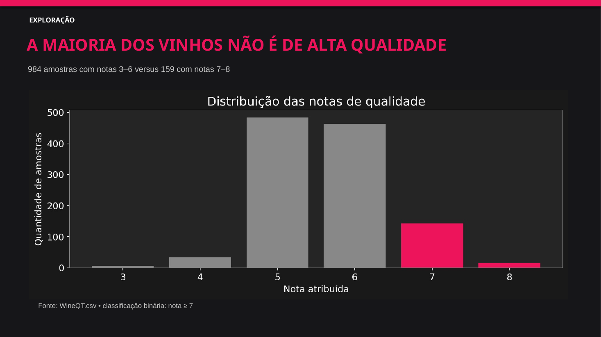
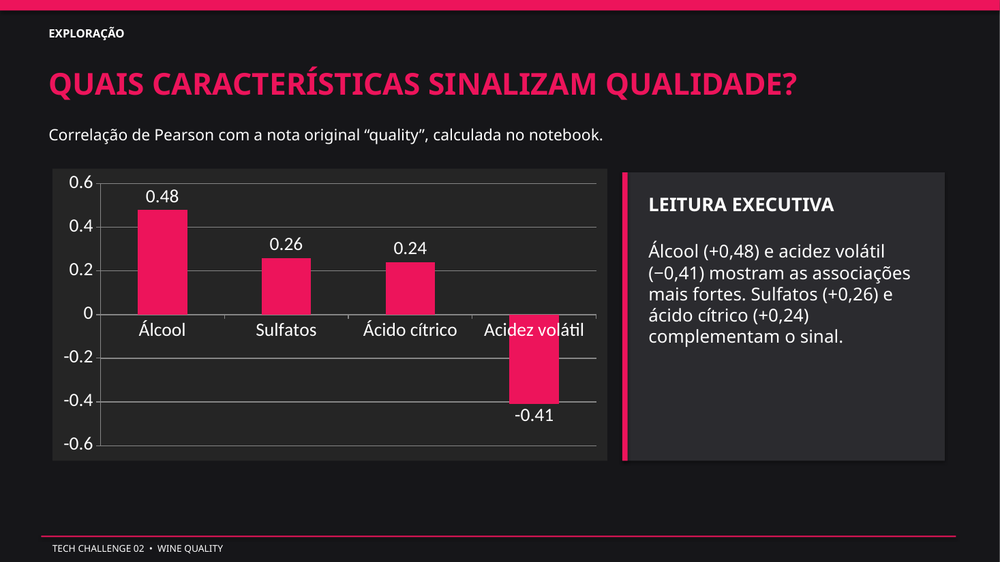
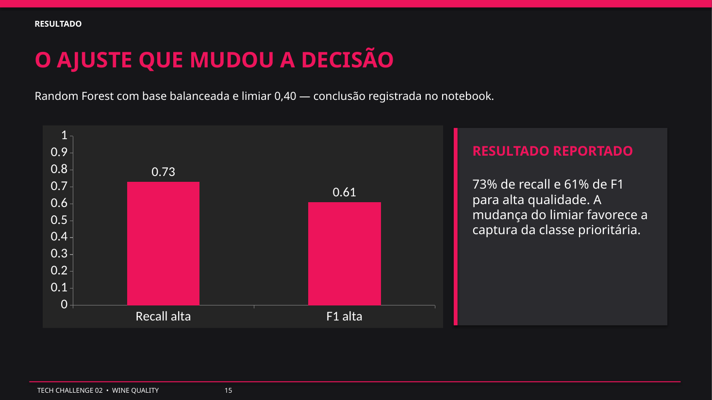
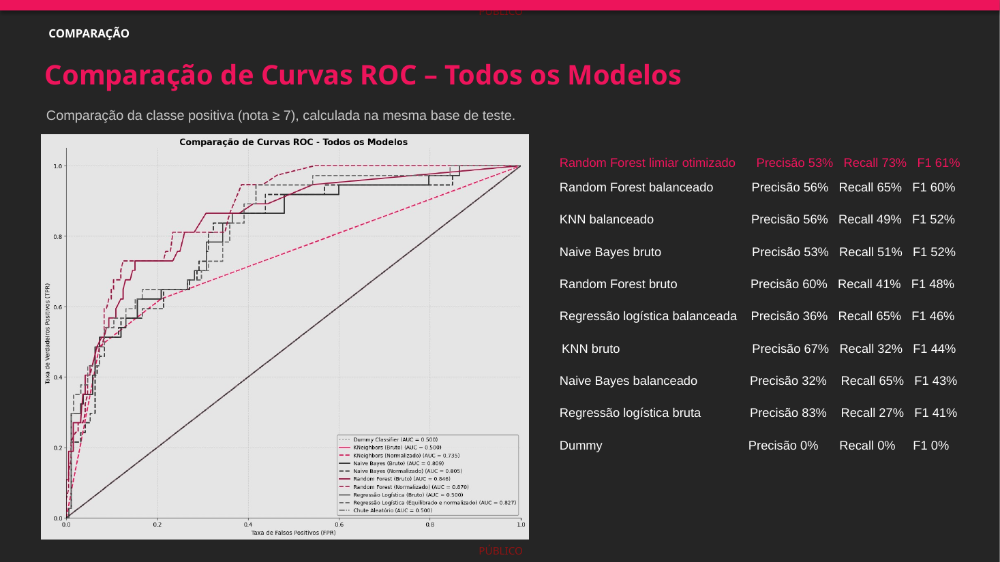

# Tech Challenge 02 — Classificação da qualidade de vinhos

Projeto acadêmico de análise exploratória e classificação da qualidade de vinhos com base em propriedades físico-químicas. Este repositório reúne o notebook concluído no Google Colab, a apresentação final e a base utilizada, seguindo a organização do projeto anterior.

## Objetivo

Investigar se as características físico-químicas ajudam a identificar vinhos de alta qualidade. A variável `quality` foi convertida em classificação binária:

- **Alta qualidade:** nota ≥ 7 (`1`)
- **Baixa ou média qualidade:** nota < 7 (`0`)

## Principais resultados

O notebook compara Dummy Classifier, KNN, Naive Bayes, Regressão Logística e Random Forest. Como as classes são desbalanceadas, a avaliação considera precisão, recall e F1 para a classe de alta qualidade, além da acurácia e das curvas ROC.

O resultado destacado no trabalho é o **Random Forest com dados balanceados e limiar de decisão 0,40**. No conjunto de teste, o notebook reporta **precisão 0,53, recall 0,73, F1 0,61 e acurácia 0,85** para essa decisão. O recall maior captura mais vinhos de alta qualidade, com aumento de falsos positivos.

A análise exploratória destaca associações com a nota de qualidade: álcool (correlação positiva de aproximadamente 0,48), acidez volátil (negativa de aproximadamente −0,41), sulfatos (aproximadamente 0,26) e ácido cítrico (aproximadamente 0,24). Correlação não implica causalidade.

## Estrutura

```text
tech-challenge-02-wine-quality/
├── data/
│   └── raw/                   # Base WineQT utilizada no notebook
├── docs/
│   ├── Apresentacao_Tech_Fase_2.pdf
│   └── Apresentacao_Tech_Fase_2.pptx
├── images/                    # Slides selecionados para consulta rápida
├── notebook/
│   └── Tech_Challenge_02.ipynb
├── requirements.txt
└── README.md
```

## Como visualizar e reproduzir

1. Abra `notebook/Tech_Challenge_02.ipynb` no Jupyter Notebook ou no Google Colab.
2. O notebook espera o arquivo `WineQT.csv` no ambiente de execução. Para executar localmente, ajuste a leitura do CSV para `data/raw/WineQT.csv` caso o caminho no notebook esteja configurado para o Colab.
3. Instale as bibliotecas listadas em `requirements.txt`.
4. Execute as células na ordem apresentada. O notebook inclui as análises, gráficos, saídas e resultados registrados.

[Visualizar o notebook no Google Colab](https://colab.research.google.com/drive/1SijrcY0Q8QJWLMd7-d5rNT2N1Z5ISaE-)

## Destaques visuais

Os slides abaixo foram exportados da apresentação final para facilitar a leitura no próprio GitHub.

**Distribuição das classes**



**Associações entre variáveis**



**Random Forest com limiar ajustado**



**Comparação das curvas ROC**



## Apresentação

- [PowerPoint final](docs/Apresentacao_Tech_Fase_2.pptx)
- [Apresentação em PDF](docs/Apresentacao_Tech_Fase_2.pdf)

## Base de dados

O arquivo `data/raw/WineQT.csv` contém 1.143 amostras e 13 colunas, incluindo o identificador `Id` e a variável `quality`. A fonte indicada no trabalho é o [Wine Quality Dataset no Kaggle](https://www.kaggle.com/datasets/yasserh/wine-quality-dataset).

## Equipe

- Alan Lima — RM 375783
- Derick Kavabata — RM 375932
- Taís Santos — RM 375962
- Victor Vallim — RM 375931
